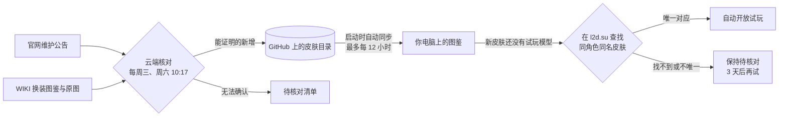

# 碧蓝航线 L2D 图鉴

**想知道某款 L2D 皮肤怎么玩？打开图鉴，一边看高清玩法图解，一边直接点人物、播动作、听语音试一试。**

这是一个 Windows 桌面程序，收录《碧蓝航线》2017 年至今的全部 L2D、L2D+ 与双形态换装。原图和图解保存在你的电脑上，离线也能看；新皮肤由云端每周自动收录，程序启动时自动同步。

[](https://github.com/gouluanjiang/azurlane-l2d-gallery/actions/workflows/ci.yml)
[](https://github.com/gouluanjiang/azurlane-l2d-gallery/actions/workflows/update.yml)


[](https://github.com/gouluanjiang/azurlane-l2d-gallery/commits/main)

[快速开始](#快速开始) · [自动更新](#自动更新) · [常见问题](#常见问题) · [问题反馈](https://github.com/gouluanjiang/azurlane-l2d-gallery/issues/new/choose) · [开发记录](PROJECT_HANDOFF.md)

> [!NOTE]
> 仓库只保存代码和皮肤目录，**不包含任何游戏图片**。原图和图解由程序从公开来源逐张下载到你的电脑并校验。试玩台的在线模型由 [l2d.su](https://l2d.su/) 提供，需要联网。

## 目录

- [现在收录了什么](#现在收录了什么)
- [核心功能：边看图解边试玩](#核心功能边看图解边试玩)
- [自动更新](#自动更新)
- [全部功能](#全部功能)：[图鉴](#图鉴) · [试玩台](#试玩台) · [更新与设置](#更新与设置)
- [快速开始](#快速开始)
- [使用前请了解](#使用前请了解)
- [隐私与数据](#隐私与数据)
- [常见问题](#常见问题)
- [未来计划](#未来计划)
- [参与项目](#参与项目)
- [致谢](#致谢)
- [免责声明](#免责声明)

## 现在收录了什么

| 项目 | 数量 |
| --- | --- |
| 换装 | **238 款**，2017-09-08 爱宕「盛夏进行曲」至 2026-10-22 |
| 本地高清原图 | 238 张，每张都核对过大小与 SHA-256 |
| 本地玩法图解 | 68 款；其余可一键搜索 Bilibili 玩法视频 |
| 可在线试玩 | 238 款，其中 7 款双形态可在 Live2D 与 Spine 动态立绘之间切换 |

收录范围与 [WIKI 换装图鉴](https://wiki.biligame.com/blhx/%E6%8D%A2%E8%A3%85%E5%9B%BE%E9%89%B4)中的 L2D、L2D+、双形态换装逐条对应。

## 核心功能：边看图解边试玩

**为什么需要它：** L2D 皮肤的有趣互动——摸头、特殊台词、隐藏动作——光看立绘看不出来，攻略图又得在另一个窗口里对照着找。

**它怎么工作：** 试玩台把两样东西放在同一个窗口里：

| 区域 | 内容 |
| --- | --- |
| 左侧 | 在线 Live2D 模型：点击人物、播放动作列表里的任意动作、听语音和台词 |
| 右侧 | 这款皮肤的本地高清玩法图解（可缩放、拖动、展开大图），以及你自己的玩法笔记 |

**如何使用：**

1. 打开图鉴，在任意卡片上点击“进入试玩”，或点上方“打开试玩台 / 切换皮肤”。
2. 等状态栏显示“模型已就绪”（一般 5～15 秒，取决于网络）。
3. 对照右侧图解，在模型上点头部、身体等位置，或展开左侧的“动作”列表直接播放。
4. 发现了有意思的互动，切到“我的笔记”写下触发位置和结果；草稿会自动保存。
5. 点“切换皮肤”可以搜索任意角色或皮肤名，换一款继续。

> 双形态皮肤在工具栏多一个“Live2D / Spine 动态立绘”切换，两种形态共用同一份笔记。

## 自动更新

**你不用做任何事。** 新皮肤上线后，通常在下一次周三或周六的云端检查后，打开图鉴时就会自动出现，并且可以直接试玩。



| 环节 | 做什么 | 什么时候 |
| --- | --- | --- |
| 云端收录 | 读取官方维护公告正文，与 WIKI 核对角色、皮肤名、类型和原图；返场不重复收录 | 每周三、周六 北京时间 10:17 |
| 本机同步 | 下载新原图并逐张校验，全部成功才切换目录；失败时保留现有图鉴，可一键回退 | 启动后约 5 秒，最多每 12 小时一次 |
| 试玩开放 | 在后台隐藏窗口里用 l2d.su 自己的搜索查找模型，只有唯一对应才开放 | 每次启动 |

两项本机自动更新都可以在“设置 → 自动更新”中关闭。

## 全部功能

### 图鉴

**使用场景：** 想翻翻某个角色有哪些 L2D 皮肤，或者找一款记不清名字的皮肤。

**如何使用：**

- 在搜索框输入角色名或皮肤名，按年份、“可查看图解 / 缺图解”筛选，按实装时间排序。
- 点击卡片图片查看玩法图解；每张卡片都有“查看原图”，查看器支持缩放、拖动和在原图与图解之间切换。
- 没有本地图解的皮肤，点击图片会打开 Bilibili 玩法视频搜索。
- 已下载的原图和图解完全离线可用。

### 试玩台

**使用场景：** 想亲手试一款皮肤的互动，或者对照图解验证某个隐藏动作。

**如何使用：**

- **加载与重试：** 网站偶尔会卡在下载途中或返回空白页，进度 30 秒不动时程序会自动重新载入（最多两次）；仍失败时点“重新尝试”或“在浏览器打开”。窗口最小化时会暂停计时，恢复后继续加载。
- **静音与侧栏：** 工具栏可以静音、重新载入、收起侧栏扩大模型区域。
- **切换皮肤：** 选择器可以按“可试玩 / 全部图鉴 / 待核对”查看，并显示每款的核对来源。
- **笔记：** 按皮肤分别保存在本机，支持编辑、移除和撤销；关闭再打开，草稿还在。

### 更新与设置

| 按钮 | 什么时候用 |
| --- | --- |
| 同步云端 | 想立刻接收云端已发布的新皮肤（平时启动会自动做） |
| 检查最新资料 | 维护刚结束、不想等周三或周六的云端检查，直接在本机读取官方公告与 WIKI |
| 更新过程 | 查看进度、失败原因，以及自动核对试玩模型的结果 |
| 设置 | 开关自动更新、打开软件文件夹、回退上一次更新 |

## 快速开始

目前还没有打包好的安装包，需要从源码构建一次：

1. 安装 [Node.js 22](https://nodejs.org/) 或更新版本，然后克隆本仓库，放在普通文件夹里（例如 `D:\碧蓝航线图鉴`）。
2. 在项目文件夹里执行：
   ```powershell
   npm ci
   npm run desktop:build
   ```
3. 双击生成的 **`碧蓝航线图鉴.exe`**。程序会自动同步，并下载有公开来源的原图（约 160 MB）和玩法图解（约 620 MB）。

之后日常使用只需要双击 `碧蓝航线图鉴.exe`，不再需要 Node.js，也不需要登录 GitHub。

> [!IMPORTANT]
> 项目早期收录的 95 款皮肤，原图来自作者本机收藏，目录里没有记录公开下载地址。在一台新电脑上，同步会在遇到第一张这样的原图时停止，并提示“缺少本地图像且没有下载来源”。补全这些来源已列入[未来计划](#未来计划)；在此之前，从源码构建主要适合开发和查看代码。

**运行环境：** Windows x64。试玩、同步和检查需要联网；已下载的图片离线可用。

## 使用前请了解

- **在线模型来自第三方网站：** l2d.su 可能改版或暂时不可用，届时试玩会受影响，图鉴本身不受影响。2026 年 11 月的一次改版已经适配。
- **图解还不完整：** 238 款中 68 款有本地玩法图解，2023-09-21 之前补录的 131 款暂时都没有。
- **只收录能证明的皮肤：** 云端只收录官方公告和 WIKI 能对上的新皮肤；试玩模型也只在网站上唯一对应时才开放。对不上的会显示“待核对”，不会猜测。
- **整个文件夹一起搬：** `碧蓝航线图鉴.exe` 依赖同目录的 `.desktop` 运行环境和 `data`、`assets`，不能只拷贝 exe。
- **不要放进沙盒工具的目录：** 被 Codex 等沙盒工具加过访问权限的文件夹里，程序可能报“图鉴启动失败 ERR_FAILED”或直接退出，移到普通文件夹即可。

## 隐私与数据

- 程序不需要任何账号，也不收集或上传使用数据。
- 原图、图解、笔记、自动核对结果和设置都保存在项目文件夹内（`assets`、`.desktop-data`），不会上传到 GitHub。
- 联网只访问这些地址：GitHub（皮肤目录）、WIKI 图床 `patchwiki.biligame.com`（原图）、`pinme.dev`（玩法图解）、Bilibili 官网与 WIKI（本机检查）、l2d.su（在线模型与自动核对）。下载地址必须是 HTTPS 且在已核对的图床名单内。

## 常见问题

**某款皮肤显示“待核对”，不能试玩？**
说明程序没能在 l2d.su 上找到唯一对应的模型：可能网站还没上线这款，或者网站上的皮肤名写法和 WIKI 差得太多。程序会在 3 天后自动再试；也可以[提交反馈](https://github.com/gouluanjiang/azurlane-l2d-gallery/issues/new/choose)。

**模型一直显示“正在加载”？**
等它自动重试一次；还不行就点“重新尝试”，或点“在浏览器打开”确认网站本身是否正常。

**新皮肤多久能出现？**
维护当天之后的第一个周三或周六 10:17 云端检查完成后，下次打开图鉴就会自动同步。想马上看，可以点“检查最新资料”。WIKI 还没更新原图时，新皮肤会先进入待核对清单，下一次检查再收录。

**能在 Mac 或浏览器里用吗？**
图鉴页面（`index-信浓泳装起.html`）可以直接用浏览器离线打开浏览；试玩台、自动同步和自动核对只有 Windows 桌面版提供。

## 未来计划

- **为早期收录的 95 款补全公开原图来源：** 让新电脑也能完整同步。
- **打包好的安装包或免安装压缩包：** 下载即用，不用自己构建。
- **补齐玩法图解：** 优先补 2023 年之前的皮肤。

这里列出的是方向，都还没有开始开发，也不代表发布日期。

## 参与项目

- **反馈问题、报告缺漏或错误的皮肤：** 请使用 [Issue 模板](https://github.com/gouluanjiang/azurlane-l2d-gallery/issues/new/choose)。
- **提交代码：** 请先阅读[贡献说明](CONTRIBUTING.md)。

### 开发者

| 组成 | 位置 |
| --- | --- |
| 桌面端（Electron 44） | `desktop/`：主进程、更新进程、图鉴界面 |
| 试玩台 | `desktop/tryout/`：模型视图、映射、站点查找与自动核对 |
| 云端与本机更新 | `scripts/`：公告与 WIKI 核对、事务式同步与回退、校验、补录 |
| 皮肤目录 | `data/catalog.json` 与供离线页面读取的镜像 `data/skins-data.js` |
| 试玩映射 | `desktop/tryout/online-mapping.json`、`online-mapping-supplement.json` |
| 测试 | `tests/`（`npm test`）；打包后的试玩实测 `desktop/run-batch-tests.ps1` |

```powershell
npm test                 # 单元测试
npm run validate         # 校验目录元数据
npm run validate:local   # 同时校验本地图片
npm run desktop:build    # 打包桌面版
```

CI 在 Windows 与 Linux 上运行单元测试和目录校验。更多资料：[开发记录与历次验收](PROJECT_HANDOFF.md)。第一至四批的分批试玩入口已经冻结，仅作历史保留。

## 致谢

- **数据：** [碧蓝航线 WIKI](https://wiki.biligame.com/blhx/)（换装图鉴与原图）、[碧蓝航线官网](https://game.bilibili.com/blhx/)（维护公告）。
- **在线模型：** [l2d.su](https://l2d.su/)。本项目只使用其公开页面与站内搜索，不读取或解析其加密数据。
- **框架：** [Electron](https://www.electronjs.org/)。

## 免责声明

本项目是非官方的爱好者工具，与《碧蓝航线》的开发与运营方、WIKI 及 l2d.su 没有关联，也不托管或分发任何游戏图片与模型。原图由使用者从公开来源下载到本机，在线模型由第三方网站提供，相关版权归原权利人所有。

请仅在当地法律和相关网站条款允许的范围内使用。
