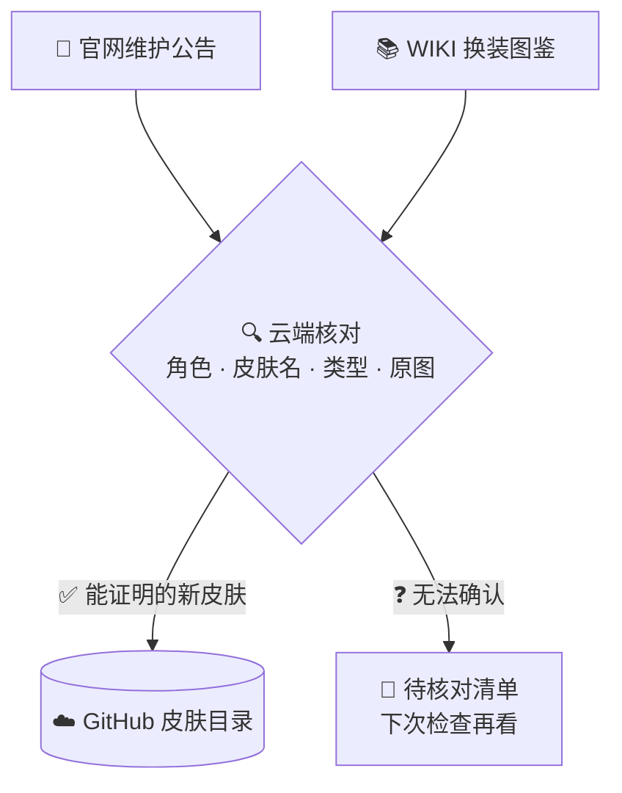
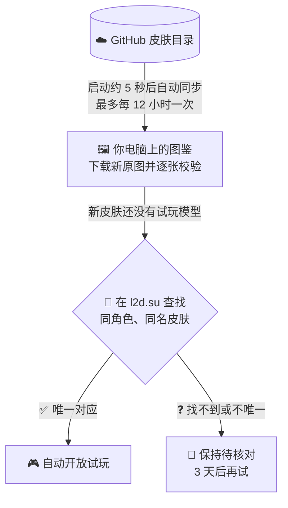

<div align="center">


# 碧蓝航线 L2D 图鉴

**翻看高清原图，一键试玩 Live2D：《碧蓝航线》全部 L2D 皮肤的本地图鉴。**

[](https://github.com/gouluanjiang/azurlane-l2d-gallery/releases/latest)

[](data/catalog.json)
[](https://github.com/gouluanjiang/azurlane-l2d-gallery/actions/workflows/update.yml)
[](https://github.com/gouluanjiang/azurlane-l2d-gallery/actions/workflows/ci.yml)
[](https://github.com/gouluanjiang/azurlane-l2d-gallery/actions/workflows/update.yml)

**[下载最新版](https://github.com/gouluanjiang/azurlane-l2d-gallery/releases/latest)** · [快速开始](#快速开始) · [使用教程](#使用教程) · [常见问题](#常见问题) · [问题反馈](https://github.com/gouluanjiang/azurlane-l2d-gallery/issues/new/choose)

</div>

收录《碧蓝航线》2017 年至今的全部 L2D、L2D+ 与双形态换装。原图保存在你的电脑上，离线也能看；想知道一款皮肤怎么玩，直接进试玩台点人物、播动作、听语音。新皮肤由云端每周自动收录，程序启动时自动同步。

> [!NOTE]
> 仓库只保存代码和皮肤目录，**不包含任何游戏图片**。原图由程序从公开来源逐张下载到你的电脑并校验；页面上的截图挂在[发行页](https://github.com/gouluanjiang/azurlane-l2d-gallery/releases/tag/v1.8.1)。试玩台的在线模型由 [l2d.su](https://l2d.su/) 提供，需要联网。

## 目录

- [亮点](#亮点)
- [快速开始](#快速开始)
- [使用教程](#使用教程)
  - [浏览图鉴](#浏览图鉴) · [铺满视图](#铺满视图) · [全屏看原图](#全屏看原图) · [试玩台](#试玩台) · [收藏](#收藏) · [更新与设置](#更新与设置) · [键盘快捷键](#键盘快捷键)
- [自动更新](#自动更新)
- [收录范围](#收录范围)
- [常见问题](#常见问题)
- [使用须知](#使用须知)
- [隐私与数据](#隐私与数据)
- [开发](#开发)
- [维护状态](#维护状态)
- [致谢](#致谢) · [免责声明](#免责声明)

## 亮点

- **全部 L2D 皮肤一屏浏览：** 从 2017 年爱宕「盛夏进行曲」到最新一期，原图铺满卡片，最新的排在最前。
- **高清原图离线可看：** 每张原图都下载到本机并核对校验值，全屏查看时可以缩放、拖动、左右翻页。
- **一键进入试玩：** 在线 Live2D 模型和图鉴在同一个窗口，点人物、播动作、听语音；回到图鉴时模型保留，随时继续。
- **双形态皮肤：** 可以在 Live2D 和 Spine 动态立绘之间切换。
- **新皮肤自动出现：** 云端每周两次核对官方公告和 WIKI，程序启动时自动同步并为新皮肤查找试玩模型。
- **键盘也能全程操作：** 搜索、选卡片、看原图、试玩、收藏都有快捷键。

## 快速开始

1. 到 [Releases](https://github.com/gouluanjiang/azurlane-l2d-gallery/releases/latest) 下载 `azurlane-l2d-gallery-<版本>-win-x64.zip`（约 150 MB）。
2. 解压到普通文件夹，例如 `D:\碧蓝航线图鉴`。不要放进 `C:\Program Files` 这类需要管理员权限的位置。
3. 双击 **`碧蓝航线图鉴.exe`**。首次启动会自动下载并校验全部原图（约 170 MB，网速正常时一两分钟）。最新皮肤的原图先下载，几十张后首屏就能看到图。

> [!TIP]
> 下载中途断网也没关系：已下载的图片会保留，下次启动或点“检查更新”会接着补。

**升级：** 下载新版压缩包，解压覆盖到原文件夹即可。设置、收藏（`.desktop-data`）和已下载的图片都会保留。有新版本时，程序右上角会提醒。

**运行环境：** Windows 10/11 x64。试玩、同步和检查需要联网；已下载的图片离线可用。

## 使用教程

### 浏览图鉴

打开程序就是图鉴首页：左边是全部皮肤的卡片，右边是当前选中皮肤的大图。

<p align="center"></p>

| 想做什么 | 怎么做 |
| --- | --- |
| 找一款皮肤 | 在顶部搜索框输入角色名或皮肤名（按 `/` 直接跳到搜索框） |
| 只看最近上线的 / 收藏的 | 点搜索框旁的“新上线”或“收藏”；近两个月上线的卡片带 NEW 标记 |
| 按类型、年份筛选，或改排序 | 点“筛选”，选 L2D / L2D+ / 双形态、年份，或改成从早到晚、按角色名；几项可以叠加，生效的条件显示在网格上方，点 × 取消 |
| 查看一款皮肤 | 单击卡片，右侧出现它的大图、类型和上线日期 |
| 进入试玩 | 点右侧的“进入试玩”，或把鼠标移到卡片上点 ▶ |
| 搜玩法视频 | 点右侧的“玩法视频”，在浏览器里搜索这款皮肤的 Bilibili 玩法视频 |

筛选条件、视图、选中的皮肤和滚动位置会保留到下次打开。

### 铺满视图

只想翻图时，点右上角的“铺满”（或按 `W`）：右栏收起，原图占满整个窗口。名字和收藏、试玩按钮在鼠标移上去时才出现，单击卡片直接全屏看原图。再点“标准”回到两栏。

<p align="center"></p>

### 全屏看原图

双击卡片、点右侧大图，或在铺满视图里单击卡片，原图会从卡片的位置放大到全屏。

<p align="center"></p>

| 操作 | 鼠标 | 键盘 |
| --- | --- | --- |
| 上一款 / 下一款 | 两侧的 ‹ › | `←` `→` |
| 缩放 | 滚轮，或底部的 − ＋ | `+` `-` |
| 适应窗口 / 原始大小 | 双击图片切换 | `0` / `1` |
| 移动放大后的图片 | 按住拖动 | |
| 收藏、进入试玩、搜玩法视频 | 底部工具条 | `F` / `P` |
| 返回图鉴 | 左上角的 ← | `Esc` |

### 试玩台

在线 Live2D 模型：点人物的头部、身体等位置触发互动，或在左侧的“动作”列表里直接播放，能听到语音、看到台词。

<p align="center"></p>

1. **进入：** 在图鉴里点“进入试玩”或卡片上的 ▶。
2. **等待加载：** 顶部状态显示“可以开始试玩”就好了，一般 5～15 秒，取决于网络。网站偶尔卡住时，程序会自动重新载入。
3. **互动：** 点模型，或在左侧动作列表里播放。不知道点哪里时，点工具栏的“搜玩法视频”。
4. **换皮肤：** 点左上角的皮肤名，可以搜索、按年份找、只看收藏，最近玩过的排在最上面；工具栏的 ‹ › 直接换上一款、下一款。
5. **双形态皮肤：** 皮肤名旁边会多一个“Live2D / Spine 动态立绘”切换。
6. **回到图鉴：** 点左上角的 ←（或按 `Esc`）。模型不会关掉，图鉴右上角会出现“继续试玩”，点它马上回来，不用重新加载。

右上角的工具栏从左到右是：上一款、下一款、收藏、静音、收起动作栏、重新载入、搜玩法视频、在浏览器打开。鼠标停在图标上会显示名称。

#### 收起动作栏

点工具栏的“收起动作栏”，左侧的动作 / 参数 / 部件栏会收起来，模型占满宽度；再点一次展开。这个选择会记在本机。

<p align="center"></p>

窗口最大化时，模型上方 l2d.su 的那一行工具条（背景、全屏、主题等）会自动隐藏，让模型铺满窗口；还原窗口后它会回来。

点工具条里的“进入网页全屏”，程序会切成真正的全屏：试玩台顶栏和窗口按钮都收起来，模型铺满整个屏幕。点右上角的退出按钮或按 `Esc` 恢复原样。

> [!NOTE]
> 动作栏和模型上方的工具条是 l2d.su 网页自己的内容，程序把它切到了网站自带的深色模式。

### 收藏

把鼠标移到卡片上点 ☆，或在右侧大图下方、全屏看原图、试玩台的工具栏里收藏；再点一次取消。点搜索框旁的“收藏”只看收藏的皮肤，试玩台的“切换皮肤”里也可以只看收藏。

收藏保存在本机的 `.desktop-data/favorites.json`，不会上传。

### 更新与设置

平时什么都不用做，程序启动时会自动检查（见[自动更新](#自动更新)）。需要手动操作时，点右上角的设置按钮：

| 位置 | 用来做什么 |
| --- | --- |
| 设置 → 检查更新 | 想立刻接收云端已收录的新皮肤 |
| 设置 → 自动更新 | 关闭启动时的自动检查，或关闭自动为新皮肤查找试玩模型 |
| 设置 → 打开软件文件夹 / 回退上次更新 | 找到程序所在的文件夹；更新后有问题时恢复到上一次更新前（已下载的图片保留） |
| 设置 → 更多 | 维护刚结束、云端还没收录时“从官方公告直接检查”；查看更新记录；快捷键一览 |
| 右上角的状态提示 | 平时不显示；正在检查、下载图片或更新失败时才出现，点它查看更新记录 |
| 右上角的“新版本 x.y.z” | 有新版本时出现，点击在浏览器打开下载页（不会自动安装） |

首次启动下载图片时，右上角会显示“正在下载图片 x / 总数”，下载好的图片会陆续出现在卡片上，不用等全部完成。

窗口没有系统标题栏：按住顶栏的空白处可以拖动窗口，双击最大化。

### 键盘快捷键

| 按键 | 作用 |
| --- | --- |
| `/` | 跳到搜索框 |
| 方向键 | 在卡片之间移动 |
| `Enter` | 全屏看选中的原图 |
| `P` | 进入试玩 |
| `F` | 收藏 / 取消收藏 |
| `W` | 切换铺满 / 标准视图 |
| `←` `→` | 全屏看原图时翻上一款 / 下一款 |
| `+` `-` `0` `1` | 全屏看原图时放大、缩小、适应窗口、原始大小 |
| `Esc` | 返回（关闭原图、离开试玩台、关闭弹窗） |

## 自动更新

**你不用做任何事。** 新皮肤上线后，通常在下一次周三或周六的云端检查后，打开图鉴时就会自动出现，并且可以直接试玩。

| 环节 | 做什么 | 什么时候 |
| --- | --- | --- |
| 云端收录 | 读取官方维护公告正文，与 WIKI 核对角色、皮肤名、类型和原图；返场不重复收录 | 每周三、周六 北京时间 10:17 |
| 本机同步 | 下载新原图并逐张校验，全部成功才切换目录；失败时保留现有图鉴，可一键回退 | 启动后约 5 秒，最多每 12 小时一次 |
| 试玩开放 | 在后台隐藏窗口里用 l2d.su 自己的搜索查找模型，只有唯一对应才开放 | 每次启动 |
| 新版本提醒 | 查询本仓库的最新 Release，有新版本就在右上角提示 | 随本机同步一起，最多每 12 小时一次 |

本机的同步和试玩查找都可以在“设置 → 自动更新”里关闭。

<details>
<summary>查看更新流程图</summary>

**① 云端：每周三、周六 北京时间 10:17**



**② 你的电脑：每次打开图鉴**



</details>

## 收录范围

| 项目 | 内容 |
| --- | --- |
| 换装 | 从 2017-09-08 爱宕「盛夏进行曲」起的全部 L2D、L2D+、双形态换装；当前数量和更新日期见顶部徽章，随云端收录自动增加 |
| 本地高清原图 | 每款一张，每张都核对过大小与 SHA-256 |
| 玩法视频 | 每款都可一键搜索 Bilibili 玩法视频 |
| 在线试玩 | 能在 l2d.su 上唯一对应的全部皮肤；双形态可在 Live2D 与 Spine 动态立绘之间切换 |

收录范围与 [WIKI 换装图鉴](https://wiki.biligame.com/blhx/%E6%8D%A2%E8%A3%85%E5%9B%BE%E9%89%B4)中的 L2D、L2D+、双形态换装逐条对应。

## 常见问题

<details>
<summary><b>某款皮肤显示“待核对”，不能试玩？</b></summary>

说明程序没能在 l2d.su 上找到唯一对应的模型：可能网站还没上线这款，或者网站上的皮肤名写法和 WIKI 差得太多。程序会在 3 天后自动再试；也可以[提交反馈](https://github.com/gouluanjiang/azurlane-l2d-gallery/issues/new/choose)。

</details>

<details>
<summary><b>模型一直显示“正在加载”？</b></summary>

等它自动重试一次；还不行就点“重新尝试”，或点“在浏览器打开”确认网站本身是否正常。

</details>

<details>
<summary><b>试玩台显示“l2d.su 网站暂时无法访问”？</b></summary>

这是提供在线模型的网站连不上或出错（域名解析失败、连接被拒、服务器 5xx 等），不是程序故障；图鉴和原图照常可用。稍后点“重新尝试”，或点“在浏览器打开”确认网站状态。显示“电脑似乎没有联网”时请先检查本机网络。

</details>

<details>
<summary><b>新皮肤多久能出现？</b></summary>

维护当天之后的第一个周三或周六 10:17 云端检查完成后，下次打开图鉴就会自动同步。想马上看，可以打开“设置 → 更多”，点“从官方公告直接检查”。WIKI 还没更新原图时，新皮肤会先进入待核对清单，下一次检查再收录。

</details>

<details>
<summary><b>窗口怎么拖动？</b></summary>

程序没有系统标题栏。按住顶栏的空白处（按钮和搜索框以外的地方）就能拖动，双击最大化；最小化、最大化、关闭按钮在右上角。

</details>

<details>
<summary><b>能在 Mac 或浏览器里用吗？</b></summary>

克隆本仓库后，图鉴页面（`index.html`）可以直接用浏览器离线打开浏览（图片需先由桌面版或 `node scripts/sync.mjs` 下载到 `assets`）；便携版压缩包里没有这个页面。试玩台、收藏、自动同步和自动核对只有 Windows 桌面版提供。

</details>

## 使用须知

- **在线模型来自第三方网站：** l2d.su 可能改版或暂时不可用，届时试玩会受影响，图鉴本身不受影响。
- **只收录能证明的皮肤：** 云端只收录官方公告和 WIKI 能对上的新皮肤；试玩模型也只在网站上唯一对应时才开放。对不上的会显示“待核对”，不会猜测。
- **整个文件夹一起搬：** `碧蓝航线图鉴.exe` 依赖同目录的 `.desktop` 运行环境和 `data`、`assets`，不能只拷贝 exe。
- **不要放进沙盒工具的目录：** 被 Codex 等沙盒工具加过访问权限的文件夹里，程序可能报“图鉴启动失败 ERR_FAILED”或直接退出，移到普通文件夹即可。
- **不再提供玩法图解：** 2026 年 11 月起图鉴不再下载和显示玩法图解（原先只有 68 款有，且不再更新）。以前下载过的图解还在 `assets/guides` 文件夹里，程序不会再用到，可以手动删除，约能腾出 650 MB。

## 隐私与数据

- 程序不需要任何账号，也不收集或上传使用数据。
- 原图、自动核对结果、收藏、设置和本机生成的卡片小图（`.desktop-data/thumbs`，约 20 MB，删掉会自动重新生成）都保存在程序文件夹内，不会上传。
- **联网只访问这些地址：** GitHub（皮肤目录，以及本仓库最新 Release 的版本号 `api.github.com/repos/gouluanjiang/azurlane-l2d-gallery/releases/latest`）、WIKI 图床 `patchwiki.biligame.com`（原图）、Bilibili 官网与 WIKI（本机检查）、l2d.su（在线模型与自动核对）。下载地址必须是 HTTPS 且在已核对的图床名单内。
- **新版本提醒**只查询版本号，请求不带任何账号或使用数据；程序不会自动下载或安装。“设置 → 自动更新”关闭时不查询。

## 开发

<details>
<summary>从源码构建</summary>

安装 [Node.js 22](https://nodejs.org/) 或更新版本，克隆本仓库后在项目文件夹里执行：

```powershell
npm ci
npm run desktop:build   # 生成 碧蓝航线图鉴.exe 与 .desktop 运行环境
npm run release:pack    # 可选：生成便携版压缩包
```

之后双击 `碧蓝航线图鉴.exe`，同样会自动下载图片。日常使用不需要 Node.js，也不需要登录 GitHub。

</details>

| 组成 | 位置 |
| --- | --- |
| 桌面端（Electron 44） | `desktop/`：主进程、更新进程、图鉴界面 |
| 试玩台 | `desktop/tryout/`：模型视图、映射、站点查找与自动核对 |
| 云端与本机更新 | `scripts/`：公告与 WIKI 核对、事务式同步与回退、校验、补录 |
| 皮肤目录 | `data/catalog.json` 与供离线页面读取的镜像 `data/skins-data.js` |
| 试玩映射 | `desktop/tryout/online-mapping.json`、`online-mapping-supplement.json` |
| 测试 | `tests/`（`npm test`）；打包后的试玩实测 `desktop/run-batch-tests.ps1` |

```powershell
npm test                 # 单元测试
npm run validate         # 校验目录元数据
npm run validate:local   # 同时校验本地图片
npm run desktop:build    # 打包桌面版
npm run release:pack     # 生成便携版压缩包
```

CI 在 Windows 与 Linux 上运行单元测试和目录校验。

- **反馈问题、报告缺漏或错误的皮肤：** 请使用 [Issue 模板](https://github.com/gouluanjiang/azurlane-l2d-gallery/issues/new/choose)。
- **提交代码：** 请先阅读[贡献说明](CONTRIBUTING.md)。开发背景与历次验收见[开发记录](PROJECT_HANDOFF.md)。

## 维护状态

项目处于稳定维护状态（2026 年 11 月发布 1.8 系列后）：新皮肤由云端每周自动收录、程序启动时自动同步，不再计划新功能。遇到问题或皮肤缺漏请[提交反馈](https://github.com/gouluanjiang/azurlane-l2d-gallery/issues/new/choose)，会在维护范围内修复（例如 l2d.su 改版、收录失败）。

## 致谢

- **数据：** [碧蓝航线 WIKI](https://wiki.biligame.com/blhx/)（换装图鉴与原图）、[碧蓝航线官网](https://game.bilibili.com/blhx/)（维护公告）。
- **在线模型：** [l2d.su](https://l2d.su/)。本项目只使用其公开页面与站内搜索，不读取或解析其加密数据。
- **框架：** [Electron](https://www.electronjs.org/)。

## 免责声明

本项目是非官方的爱好者工具，与《碧蓝航线》的开发与运营方、WIKI 及 l2d.su 没有关联，也不托管或分发任何游戏图片与模型。原图由使用者从公开来源下载到本机，在线模型由第三方网站提供，相关版权归原权利人所有。

请仅在当地法律和相关网站条款允许的范围内使用。
